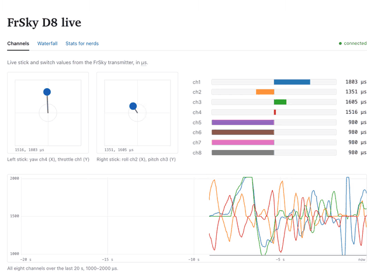

# esp32-d8rx

**A $5 ESP32 as a 2.4 GHz SDR: gapless I/Q over USB serial, and live FrSky D8 decoding across all 47 hops.**

[Writeup: A 2.4 GHz SDR on a $5 ESP32](docs/devkitv1/writeup/README.md) · [Build and use](docs/devkitv1/README.md) · [TX follow-up: esp32-d8tx](https://github.com/mb6611/esp32-d8tx)

Built on [ESPARGOS esp-sdr](https://github.com/ESPARGOS/esp-sdr) (GPL-3.0); the firmware here is esp-sdr with DevKit V1 extensions. Upstream README: [docs/esp-sdr.md](docs/esp-sdr.md).



Receive only. Nothing in this repo transmits.

## What this is

I wanted to see whether a classic ESP32 DevKit V1, the cheap board with a CP2102 USB-serial chip, could work as a 2.4 GHz software-defined receiver, and whether it could listen to the FrSky D8 link between my EMAX E8 radio and my drone.

[esp-sdr](https://github.com/ESPARGOS/esp-sdr) had already found an undocumented debug path in the ESP32's Wi-Fi radio that copies raw I/Q samples into RAM. On the classic ESP32 it took snapshots: about 1 ms of radio at 16 MS/s, then a pause while the 32 KB capture went out over serial. Its build also expected a 2 Mbaud UART, which the CP2102 can't do; asked for 2 Mbaud, the board just never replies.

What I added:

- **A DevKit V1 build profile** (`esp32-devkitv1`) with the UART at 921600 baud, the CP2102's ceiling.
- **Gapless I/Q streaming on the classic ESP32.** The capture window is two 32 KiB banks. The radio writes one while the CPU reads the other, and the second core swaps them on a fixed schedule. Core 0 filters and decimates the 16 MS/s stream so it fits in 921600 baud: 31.25 kS/s at 8 bits, or 250 kS/s in a 1-bit mode that keeps only the signs of I and Q, which is all FSK needs. Three 20-second runs at 250 kS/s had no gaps and no lost samples.
- **`FOFS` fine tuning** in kHz on the classic ESP32, so a channel can sit exactly where I want it instead of on a whole MHz.
- **Hop following.** The host loads the 47 D8 channel frequencies into the board once and schedules retunes in stream samples, so each one lands in the gap of about 2 ms between packets.
- **A host package, `esp32sdr`**: captures to SigMF, continuous streams, an rtl_tcp bridge for SDR++ and gqrx, an offline D8 decoder and `d8live`, a live D8 decoder with a web page of sticks and channels.

The results, each from a file in this repo:

- On one channel, `d8live` decoded 649 of 649 visits in a 274 s run, about 2.4 packets a second ([writeup](docs/devkitv1/writeup/README.md)).
- Following the hops, a 159 s `d8live --follow` run decoded **108 CRC-valid packets a second, 97.7% of hop slots** (17,155 of 17,557), with 0 lock losses and 0 lost stream samples. 46 of the 47 channels decode at 97–100% ([hop-follow.md](docs/devkitv1/hop-follow.md)).
- When the lock was knocked off on purpose, the follower noticed after 47 hops (0.44 s) and locked again 0.11–0.37 s later ([hop-follow.md](docs/devkitv1/hop-follow.md)).
- A 2.5-minute SDR++ session with retunes lost 0 samples ([writeup](docs/devkitv1/writeup/README.md)).

The full story, with Wi-Fi and Bluetooth LE along the way, is in the [writeup](docs/devkitv1/writeup/README.md) ([HTML version](docs/devkitv1/writeup/index.html)). The next step, getting the same board to transmit D8 and fly the drone, is [esp32-d8tx](https://github.com/mb6611/esp32-d8tx) ([live app](https://d8tx.mb6611.workers.dev)).

## Quick start

Full steps, the toolchain pin and bench recovery are in [docs/devkitv1/README.md](docs/devkitv1/README.md).

Build and flash (ESP-IDF, always at 921600):

```sh
. ~/esp/esp-idf/export.sh
idf.py -B build-esp32-devkitv1 -DIDF_TARGET=esp32 -DSDKCONFIG_DEFAULTS=sdkconfig.defaults.esp32-devkitv1 build
idf.py -B build-esp32-devkitv1 -p /dev/cu.usbserial-0001 -b 921600 flash
```

Install the host tools:

```sh
cd host && python3 -m venv .venv && . .venv/bin/activate && pip install -e .[dev,plot]
```

Run it, from the repo root with the venv active:

```sh
esp32sdr info
esp32sdr sdrpp                                    # live waterfall in SDR++
(cd host/web/d8live && npm install && npm run build)   # once, for the d8live page
esp32sdr d8live --follow --gain 40 --open         # FrSky D8, all 47 hop channels
```

## Repo

| Path | What |
|---|---|
| `main/` | firmware; the classic ESP32 additions are in `main/targets/esp32/` |
| `sdkconfig.defaults.esp32-devkitv1` | the DevKit V1 build profile |
| `host/` | Python package `esp32sdr` (CLI, bridge, D8 decoder, hop follower) and tests |
| `host/web/d8live/` | the `d8live` web page |
| `docs/devkitv1/` | [build and use](docs/devkitv1/README.md), [writeup](docs/devkitv1/writeup/README.md), [hop following](docs/devkitv1/hop-follow.md), [UART link budget](docs/devkitv1/iq-stream-uart.md), [bench results](docs/devkitv1/bench-results.md) |
| `bench/cc2500-rxdiag/` | CC2500 receive diagnostics used on the bench |
| `docs/esp-sdr.md` and the rest of `docs/` | upstream esp-sdr documentation |

## License

GPL-3.0-or-later, see [LICENSE](LICENSE). A few upstream parts are Apache-2.0 under their own licenses; [NOTICE.md](NOTICE.md) lists them and the upstream commit this is based on.
