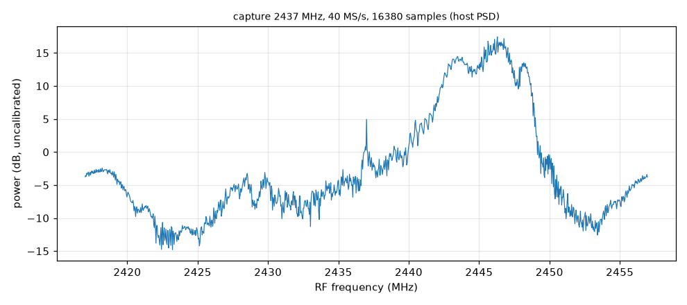
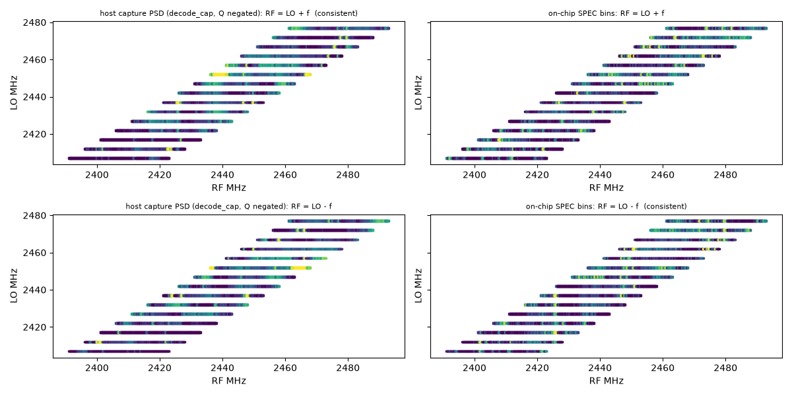

# 02 · Burst capture: first look, I/Q orientation, robustness

Before streaming, I wanted to know whether esp-sdr's plain burst capture works on this board well enough to build on: grab 16380 samples, send them over USB, look at them. These are three short checks of that path, run back to back between 13:09 and 13:28. If any of them had failed, nothing later would have worked.

The first thing to fix was the host. The `esp32sdr` transport set pyserial's timeout before every read, one byte at a time for line reads, and on this board's CP2102 link that dropped bytes: `VERSION?` timed out, and capture headers and spectrum frames came back corrupted (I had seen the same thing in [01](../01-ring-feasibility/README.md)). I changed it to open the port once with a fixed 50 ms timeout, read whatever is waiting in bulk, and enforce deadlines itself. After that every command answered and every capture below passed its CRC.

Then I tuned to Wi-Fi channel 6 (2437 MHz) and took one capture at 40 MS/s: 16380 samples, 410 µs of signal. It happened to catch a packet occupying about 2440 to 2449 MHz, roughly 20 dB above the rest of the span; the peak was at 2446.297 MHz, 17.4 dB against a median of −5.1 dB. I also took two 1-second spectra computed on the chip (86 and 87 frames, mean and max-hold). They showed energy across 2427 to 2447 MHz, but with the flat-topped shape of the receiver's own filter, about ±8 to 10 MHz wide, so the shape alone doesn't prove Wi-Fi. The packet in the single capture does.



*Figure: one capture, 2437 MHz, 40 MS/s, 16380 samples. Written by `esp32sdr capture --psd` during the run. Source: `data/first-capture/ch6.sigmf-*`.*

Next I needed to know which way round the samples are: whether a signal above the tuned frequency (the LO) shows up at +f in my samples or mirrored at −f. If that is wrong, every frequency after it lands on the wrong side. The obvious test was to tune 10 MHz below a busy channel and look for energy at +10 MHz. With only ambient traffic that was ambiguous. The band is busy on both sides of every LO (Wi-Fi on channels 1, 3, 6 and 11, plus Bluetooth), and only about 6 to 20% of 410 µs captures held a burst at all. Counting 120 captures per LO, bursts on the expected side against the other side came out 17 against 21, 18 against 14 and 7 against 5, which says nothing.

So I used a test that doesn't depend on where the traffic is. I stepped the LO from 2407 to 2477 MHz in 5 MHz steps and at each step recorded a max-hold spectrum of 25 captures, plus a 2 s max-hold from the on-chip spectrum. A real signal stays at the same radio frequency as the LO moves, but only if the samples are mapped the right way round; mapped the wrong way, it moves by twice the LO step. For each pair of LO steps 5 to 15 MHz apart, I correlated their spectra under both mappings, after removing the fixed shape of the receiver filter. For the host's samples, "RF = LO + f" gave a correlation of +0.218 and the mirror −0.007, and it fit better in 32 of 39 pairs. For the on-chip spectrum it was the other way: +0.276 for the mirror, and only 4 of 39 pairs favoured LO + f. So the host's I/Q is the right way round, and the firmware's spectrum bins are mirrored, because it takes the FFT of the raw `(I, −Q)` words. The host now flips them (`spec_cmd.SpecRun.rf_axis_hz`).



*Figure: spectra of the LO sweep placed on an RF axis under each mapping; features line up across LO steps only under the right one. Source: `data/iq-orientation/sweep.npz`, `scripts/plot.py`.*

Then I checked that captures don't fail now and then, since a receiver that hangs on the 40th try is no use for long runs. I ran 50 separate `esp32sdr capture` processes in a row (each one opening the port, syncing, tuning, capturing and releasing), 84 s in total, then one session with 50 back-to-back captures at each of the three rates (80, 40, 16 MS/s) in both 8 and 10 bits. That is 350 captures with no CRC failure, reset or hang. Each 8-bit capture took 361 to 362 ms and each 10-bit one 451 to 452 ms, almost all of it the UART: 32,760 bytes at 921600 baud take about 355 ms. Asking for 2600 or 1849 MHz was refused on the host, outside the 1850 to 2500 MHz range, before anything was sent.

So the board receives, the host's I/Q is the right way round, and burst capture is repeatable. What it can't do is listen for more than 1 ms at a time: each capture is followed by about 355 ms of transfer, which is why the next step was a continuous stream ([03](../03-iq-stream/README.md)).

---

## Numbers

| What | Value | Where |
|---|---|---|
| First capture: peak / median | 2446.297 MHz, 17.4 dB / −5.1 dB | notes/first-capture.md |
| LO pairs favouring RF = LO + f, host / on-chip spectrum | 32 / 39, 4 / 39 | `scripts/pairs.py` |
| Correlation, host, LO + f vs LO − f | +0.218 vs −0.007 | notes/iq-orientation.md |
| Captures without a failure | 350 (50 processes + 6 × 50 in one session) | notes/robustness.md |

## Files

- [notes/](notes/): the original notes of the checks; [data/DATA.md](data/DATA.md) lists all data.
- First capture: `data/first-capture/ch6.sigmf-*`. `figures/ch6-capture-psd.png`, `ch6-spec.png`, `ch6-spec-max.png` were written by the `esp32sdr` CLI during the run (`--psd`, `spectrum -o`); there is no separate plotting script, so they can't be remade offline.
- Orientation: `data/iq-orientation/sweep.npz` (the LO sweep). `scripts/plot.py` draws `figures/orientation-sweep.png`; `scripts/pairs.py` prints the pair counts; both offline. `scripts/sweep.py` (wrote `sweep.npz`), `orientation_sweep.py` (the tidied version), `burst.py` (the ambiguous single-LO test), `orient.py`, `side.py` need the board; all but `orientation_sweep.py` were recovered from `/tmp` as found.
- Robustness: `data/robustness/b2b.*`, one capture from the session and its console line. `scripts/loop.py` is the back-to-back loop (needs the board). Not kept: the console output of the 50-process loop and of `loop.py`; the per-rate numbers survive only in [notes/robustness.md](notes/robustness.md).
- Also in `data/fresh-clone/`: a timing run of the setup steps from a clean clone (a documentation check, not a radio measurement).

## How to re-run

The offline parts:

```sh
host/.venv/bin/python experiments/02-burst-capture/scripts/plot.py    # -> figures/orientation-sweep.png (set OUT=dir to write elsewhere)
host/.venv/bin/python experiments/02-burst-capture/scripts/pairs.py   # -> "32/39" and "4/39"
```

With the board connected: run the commands in [notes/first-capture.md](notes/first-capture.md) for the first capture, `scripts/orientation_sweep.py` for the LO sweep (about 4 min), and `scripts/loop.py` for the robustness loop.

## Ran

2026-11-05 13:09–13:28 EST: first capture 13:09; orientation 13:10–13:25 (`orient.py` 13:10, `sweep.npz` and figure 13:15, `orientation_sweep.py` 13:25); robustness 13:21. Commits 0f222b0 (host package) and 6a6510d (results), 15:17–15:18.

**Overlap:** The robustness loop ran while the orientation sweep script was being tidied.

[← 01-ring-feasibility](../01-ring-feasibility/README.md) · [index](../README.md) · [03-iq-stream →](../03-iq-stream/README.md)
