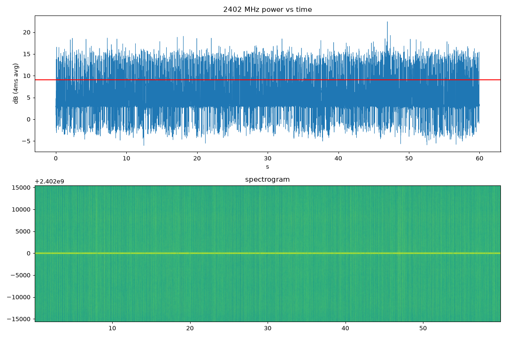

# 03 · A continuous I/Q stream over the UART

Burst capture ([02](../02-burst-capture/README.md)) gives about 1 ms of radio and then 355 ms of transfer, so it misses almost everything that comes and goes, like Bluetooth advertising or a hopping radio control link. I wanted a continuous stream instead, over the board's 921600-baud serial link, with every lost sample counted.

The difficulty is the rate. 921600 baud carries 92,160 bytes a second. The radio at 16 MS/s with 8-bit I and Q produces 32 MB/s, about 350 times more. So the chip has to filter and throw away almost everything before it sends anything. I built it on the ping-pong ring from [01](../01-ring-feasibility/README.md): the radio writes one 32 KiB bank while the CPU reads the other, the second core runs bare-metal, swaps the banks and does a cheap decimate-by-16, and the main core runs a FIR filter that decimates by the rest, rounds the samples to 4, 8 or 16 bits and packs them into frames. Each frame has a 24-byte header with the index of its first sample, up to 1024 bytes of samples and a CRC32. Because every frame says where it starts, the host can count exactly how many samples are missing between frames, and the firmware counts any samples it lost at its own end and reports them in an `IQSEND` line when the stream stops. Settings that don't fit the link are refused before the radio is touched. Only 16 MS/s is allowed, because 01 showed the filter and the seam loss fit at that rate.

The setting I tested was dec 512, 8-bit: 16 MS/s / 512 = 31.25 kS/s, 62,500 bytes a second of samples, 64,209 with framing, which is about 70% of the link. I tuned to 2402 MHz, a Bluetooth advertising channel, and ran it twice for 60 s. The first run used a raw-serial script (`u6b_iqs.py`) that checks frames and counts losses itself; it got 3663 frames, 1,874,990 samples and 3,852,603 bytes in 60.0 s, with 0 bad CRCs, 0 sequence errors and 0 index jumps. The firmware's own count agreed: it had filtered 959,995,020 radio sample pairs and lost 0. The second run went through the normal `esp32sdr stream` command and saved a SigMF recording, with the same result: 1,874,990 samples in 3663 frames, 0 bad CRCs, 0 gaps, and 0 lost samples by both the host's and the firmware's count.

In the recording I could see bursts from nearby Bluetooth devices: 39 distinct bursts at least 6 dB above the median in 60 s. They were irregular, with a median spacing of about 1.07 s and 10 to 90% of spacings between 0.34 and 2.56 s. Several devices were advertising at once, so no single interval stood out, and I couldn't pick out one particular device. A 31.25 kS/s stream also only sees about 31 kHz of a 1 MHz Bluetooth channel, so some packets are missed entirely. Picking out one device needed a controlled source I could switch on and off, which I did in [06](../06-ble-advertising/README.md).

This shows that one setting, 8-bit at 31.25 kS/s, streams for 60 s without loss. It doesn't test the other allowed settings at length, and it doesn't check the sample values across bank swaps against a known signal, only that none are missing. The next step was to get the stream into ordinary SDR software ([04](../04-rtltcp-bridge/README.md)).

*Figure: 60 s at 2402 MHz, dec 512, 8-bit: power in 4 ms steps and a spectrogram. Source: `data/ble.sigmf-*`; the plotting script was not kept.*

---

## Numbers

| What | Value | Where |
|---|---|---|
| Samples / frames in 60 s | 1,874,990 / 3663 | `data/u6b_60s.log`, notes.md |
| Bad CRCs, sequence gaps, lost samples | 0, 0, 0 | `data/u6b_60s.log`, notes.md |
| Radio pairs filtered by the firmware, lost | 959,995,020, 0 | `IQSEND` in `data/u6b_60s.log` |
| Bursts ≥ 6 dB above median in 60 s | 39 | notes.md |

## Files

- [notes.md](notes.md): original notes.
- `data/u6b_60s.log`: the 60 s run from `scripts/u6b_iqs.py` (frame, CRC and loss counters). `data/ble.sigmf-*`: the 60 s recording at 2402 MHz (the `.sigmf-data` file is in the release asset). See [data/DATA.md](data/DATA.md).
- `figures/u75-ble-2402.png`: its plotting script was not kept.
- The link budget and the full table of allowed settings: [docs/devkitv1/iq-stream-uart.md](../../docs/devkitv1/iq-stream-uart.md).

## How to re-run

With the board connected, run `esp32sdr stream --freq 2402 --dec 512 --bits 8 --seconds 60 -o ble`, or `scripts/u6b_iqs.py` (raw serial, port hard-coded to `/dev/cu.usbserial-0001`).

## Ran

2026-11-05 13:33–13:37 EST (build 13:33, `u6b_60s.log` 13:34, recording 13:36). Commits 13f6240, 3d79a74 (15:17–15:18), results in 6a6510d.

[← 02-burst-capture](../02-burst-capture/README.md) · [index](../README.md) · [04-rtltcp-bridge →](../04-rtltcp-bridge/README.md)
