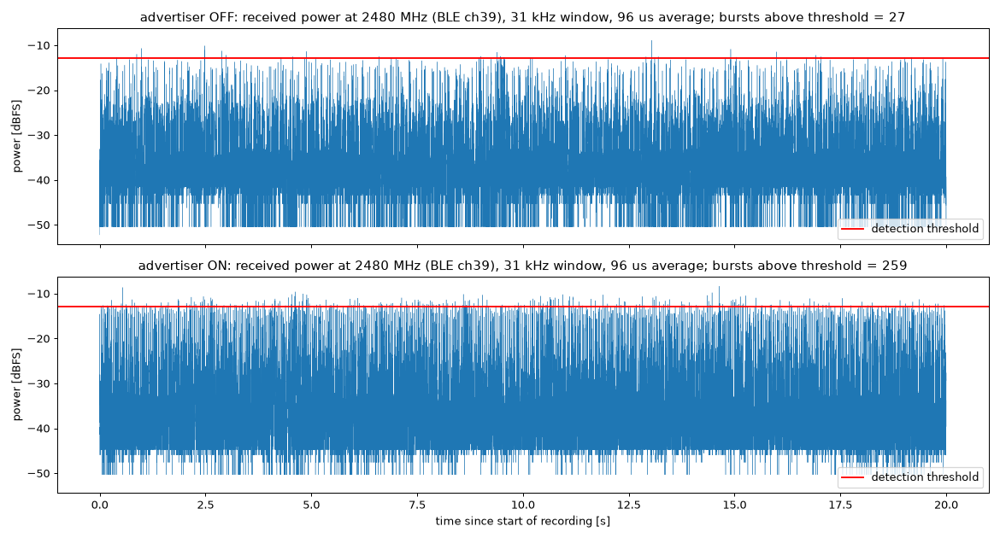
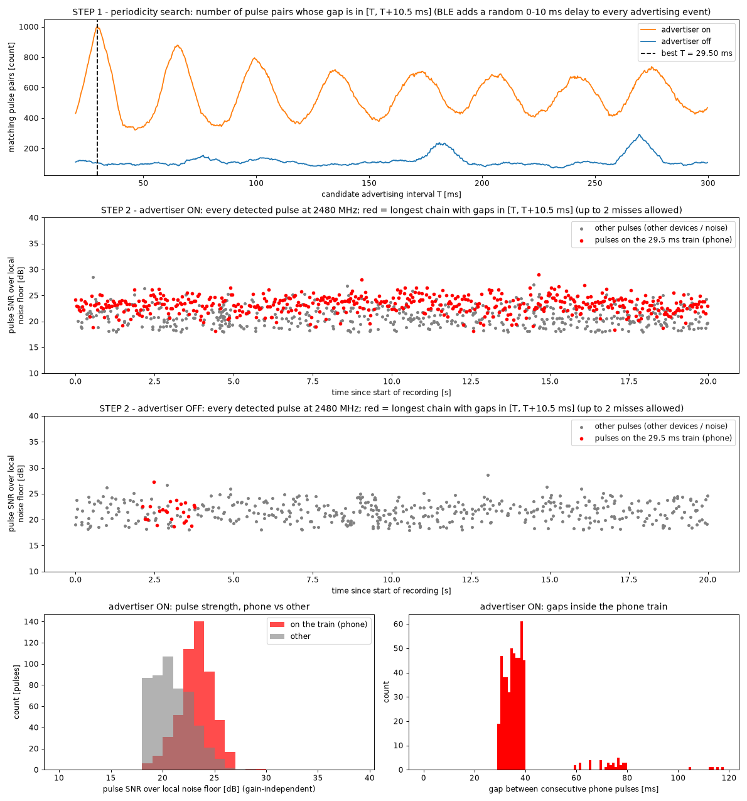
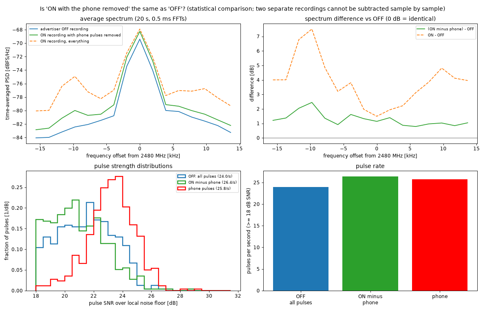
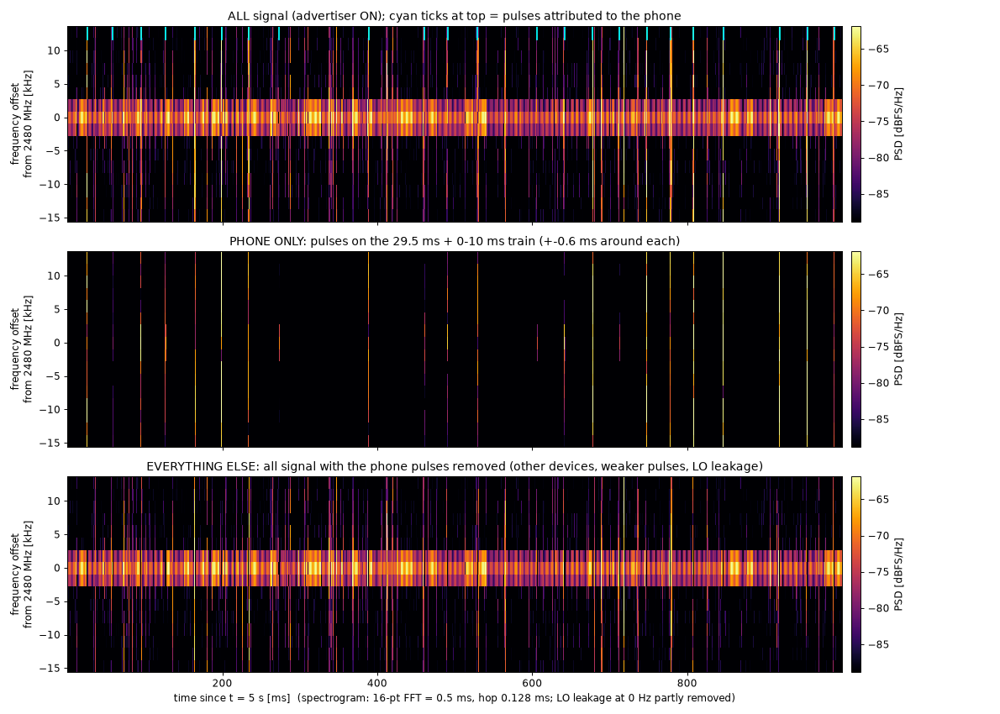

# 06 · Seeing a phone's Bluetooth advertising

In [03](../03-iq-stream/README.md) the stream showed Bluetooth bursts at 2402 MHz, but several devices were advertising at once and I couldn't say which burst came from which. I wanted a controlled test: a signal I could switch on and off, to show that the board sees one specific device and not just background traffic.

I put my iPhone on top of the board, running nRF Connect's advertiser with the iOS default interval and power, and recorded 20 s at 2480 MHz with the advertiser off and then 20 s with it on, the phone in the same position. 2480 MHz is Bluetooth advertising channel 39, above the Wi-Fi channels. The stream ran at dec 512, 8-bit, 31.25 kS/s, with 0 lost samples in every run. It only sees about 31 kHz of the 1 MHz channel, which is not enough to decode a packet, but enough to see its energy.

The first comparison was a simple count. I removed DC, smoothed the power over 3 samples (96 µs), set the threshold at the 99.99th percentile of the off run, and merged events closer than 2 ms. With the same threshold, the off run had 27 events in 20 s (1.35 a second, median spacing 400 ms, no pattern), and the on run had 259 (12.95 a second, median spacing 66 ms), about ten times more. The spacings in the on run peaked at about 35 ms, with smaller peaks at 70, 105 and 140 ms, which I read at the time as a 35 ms advertising period with some packets missed. There is also an earlier 20 s recording, `first_unsure`, with 56 events above the same threshold; the notes don't say what state the advertiser was in, so I left it out of the comparison.

A count alone doesn't say the extra bursts are the phone. Other devices in the room advertise too, and the hardware AGC picked a slightly different gain for each run (gain index 58 off, 60 on), so absolute levels aren't exactly comparable. So I looked for the phone's timing instead. A Bluetooth device sends an advertising packet every *advInterval* plus a random delay of 0 to 10 ms, so the gaps between its packets fall anywhere between T and T + 10 ms, never at one fixed value. That is also why the first histogram peaked at 35 ms: it is roughly the middle of that window.

For this I counted pulses differently, as local peaks at least 18 dB above a 50 ms running median of the noise, which doesn't depend on the gain. That gave 1026 pulses in the on run and 479 in the off run. Then, for each candidate T, I counted pulse pairs whose gap falls between T and T + 10.5 ms. The on run has a sharp peak at T = 29.5 ms, with harmonics; the off run has nothing there. Then I looked for the longest chain of pulses in which each gap is T plus up to 10.5 ms, allowing up to two missed packets. In the on run 515 of the 1026 pulses form one train covering the whole 20 s, 89% of the packets a 29.5 ms interval plus an average delay of about 5 ms would give, with most gaps between 29.5 and 40 ms and a few near twice that, where a packet was missed. In the off run only 24 pulses chain up that way by chance, 4% of that number. The train pulses are also stronger than the rest, a median of 23.3 dB above the noise against 20.7 dB, which fits a phone lying on the board; in the off run the two groups are 21.7 and 21.6 dB. The off run does have a weaker periodic source of its own, near 90 ms with peaks at 180 and 270 ms, which is some other nearby device.

As a check, I cut 0.6 ms on each side of every train pulse out of the on recording and compared what was left with the off recording. The difference in average spectrum fell from up to 7.5 dB (on against off) to 0.8 to 2.4 dB, and the remaining pulse rate, 26.4 a second, came out close to the off run's 24.0. So once the phone's train is removed, the on recording looks much like the off one, though not exactly.

This picks out one phone's packets by their timing and strength alone, with 31 kHz of a 1 MHz channel. It doesn't decode them, so it can't confirm the address or content, and it relies on the phone being much closer than anything else. That was good enough to move on to the drone's radio link ([07](../07-d8-maxhold/README.md)).



*Figure: power at 2480 MHz, 20 s each, same threshold (99.99th percentile of the off run). Source: `data/{off,on}.sigmf-*`, `scripts/analyze.py`.*



*Figure: step 1, number of pulse pairs with a gap between T and T + 10.5 ms, advertiser on and off; step 2, every pulse at 2480 MHz, with the longest 29.5 ms chain in red; bottom, pulse strength of train and other pulses, and the gaps inside the train (advertiser on). Source: `data/{off,on}.sigmf-*`, `scripts/isolate.py`.*



*Figure: the on recording with the phone's train removed, against the off recording. Source: `scripts/residual.py`.*



*Figure: one second of the on recording, split into the phone's pulses and everything else.*

---

## Numbers

| What | Off | On | Where |
|---|---|---|---|
| Events above the off run's 99.99th percentile, 20 s | 27 | 259 | `scripts/analyze.py` |
| Pulses ≥ 18 dB above local noise | 479 | 1026 | `scripts/isolate.py` |
| Pulses on the 29.5 ms train | 24 (4%) | 515 (89%) | `scripts/isolate.py` |
| Median SNR, train / other pulses | 21.7 / 21.6 dB | 23.3 / 20.7 dB | `scripts/isolate.py` |
| Pulse rate, off / on with phone removed | 24.0 /s | 26.4 /s | `scripts/residual.py` |

The train span is 19.97 s as `isolate.py` computes it; the original notes say 19.6 s.

## Files

- [notes.md](notes.md): original notes with the detection details.
- `data/{off,on,first_unsure}.sigmf-*`: the three recordings (the `.sigmf-data` files are in the release asset). See [data/DATA.md](data/DATA.md).
- `scripts/`: `analyze.py` (counts, `on/off/first_unsure/compare_on_off.png`), `isolate.py` (the 29.5 ms train, `phone_isolation.png`), `residual.py` (`residual_vs_off.png`), `spec_isolated.py`, `spec_onoff.py` (spectrograms). All offline.
- `figures/on_v2_view.png`: its script was not kept.

## How to re-run

Fetch the release data first: `experiments/fetch-data.sh`.

```sh
for s in analyze isolate residual spec_isolated spec_onoff; do
  host/.venv/bin/python experiments/06-ble-advertising/scripts/$s.py; done   # -> figures/ (OUT=dir to write elsewhere)
```

## Ran

2026-11-05 14:10–14:24 EST (recordings 14:10–14:12, scripts and figures 14:15–14:24). Commit 6a6510d (15:18).

[← 05-live-view-sdrpp](../05-live-view-sdrpp/README.md) · [index](../README.md) · [07-d8-maxhold →](../07-d8-maxhold/README.md)
