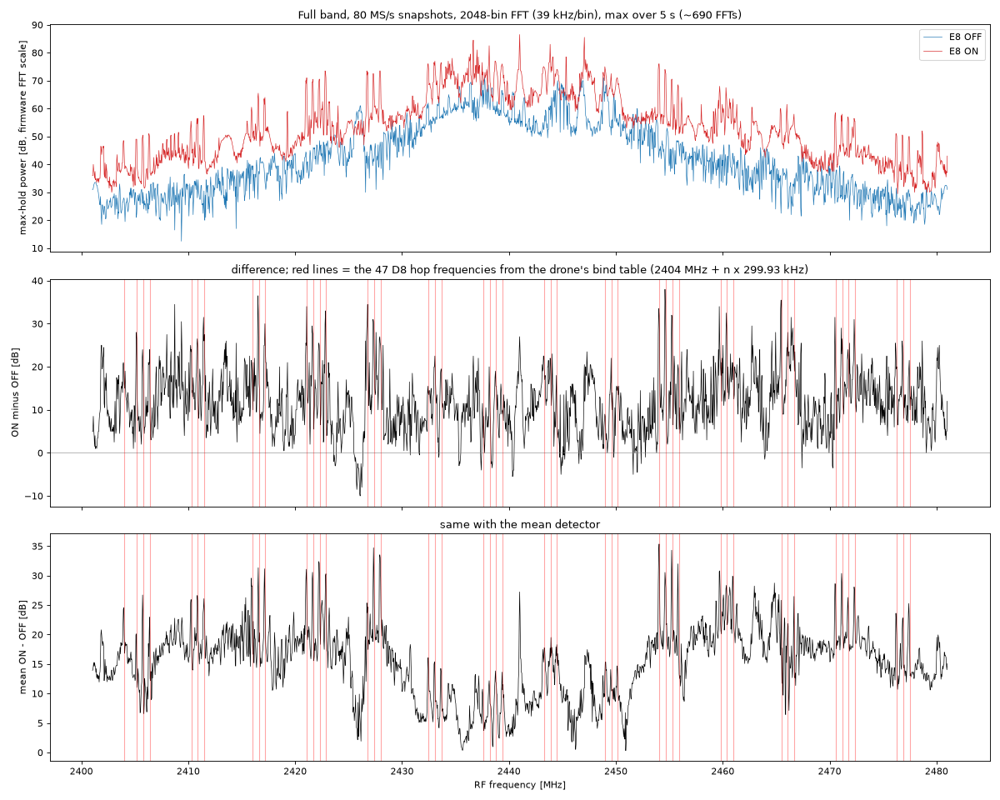
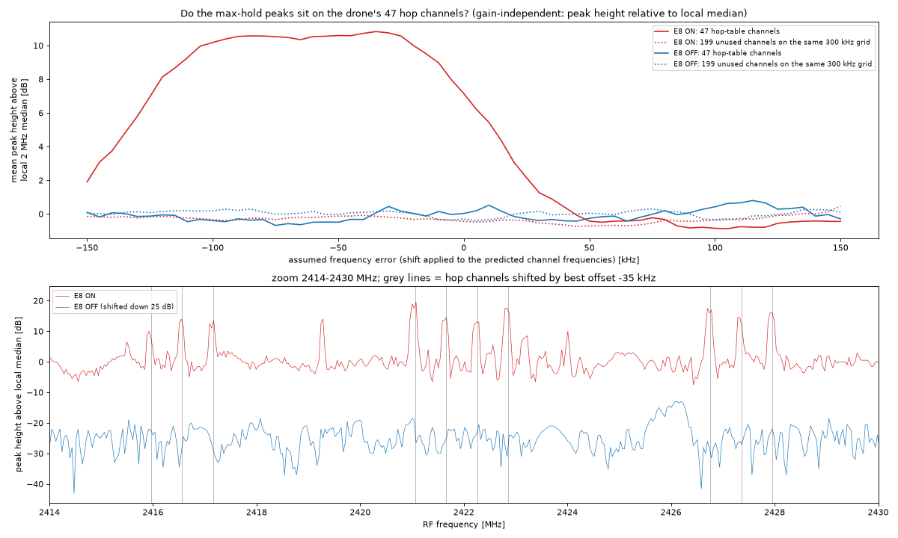

# 07 · Seeing the D8 hop channels in max-hold

After the phone ([06](../06-ble-advertising/README.md)) I turned to the drone's radio link: my EMAX E8 controller, which speaks FrSky D8. A D8 transmitter hops over 47 channels, about every 9 ms, and the receiver follows the same sequence. The drone's Betaflight backup has the list (`frsky_spi_bind_hop_data`, 47 entries), and with Betaflight's CC2500 settings channel *n* is at 2404.000 MHz + *n* × 299.93 kHz. The modulation is GFSK at about 31 kbaud with ±31.7 kHz deviation. Before trying to read any of it, I wanted to know whether the board sees the E8 at all, and whether the energy shows up exactly on the 47 channels the table says.

The stream from [03](../03-iq-stream/README.md) only sees 31 kHz, one channel at a time, while the hops span 2404 to 2478 MHz. So I used the on-chip spectrum instead. Tuned to 2441 MHz at 80 MS/s, it covers about 2401 to 2481 MHz in 2048 bins of 39 kHz. Each FFT is a snapshot well under a millisecond long, and in max-hold mode the firmware keeps the highest level each bin has seen. Over 5 s (about 690 FFTs) the E8 comes round to every channel many times, so each of its channels should leave a peak. I recorded 5 s with the E8 on, about 0.5 to 1 m from the board with the drone off, then 5 s with it off.

The obvious comparison, on minus off, wasn't selective. At the 47 table frequencies the difference had a median of 25.5 dB, and all 47 were above 6 dB, but at 2000 random positions in the band the median was 18.0 dB, and 97.2% were above 6 dB. The whole max-hold came out higher in the on run, so the plain difference can't tell the table channels from anything else. The levels are also uncalibrated, since the hardware AGC sets the gain.

So I measured each bin's height above the median of the bins around it, over about 2 MHz (51 bins). That removes the overall level and the shape of the receiver's filter, and leaves narrow peaks. Then I compared the average peak height at the 47 table channels with the average at the other 199 positions on the same 299.93 kHz grid, which the E8 never uses. Because the E8's crystal and the board's both have some error, I shifted the predicted frequencies by an assumed error from −150 to +150 kHz in 5 kHz steps and took the best. At −35 kHz the 47 table channels stood +10.8 dB above their surroundings and the 199 unused positions −0.1 dB. With the E8 off, both were +0.1 dB. So the energy sits on the table channels and not on the grid in general.



*Figure: 80 MS/s, 2048 bins (39 kHz), max over 5 s. Top: max-hold, E8 on and off. Middle: on minus off; red lines are the 47 hop frequencies from the bind table. Bottom: the same with the mean detector. Source: `data/spec_{on,off}.npz`, `scripts/plot_maxhold.py`.*

The fit doesn't pin the frequency error down well. The score is nearly flat for any error between about −100 and −30 kHz, which is not surprising: the bins are 39 kHz wide and the signal itself is about 95 kHz wide. At the time I only knew it was a combined error of the E8 and the board, somewhere in that range. Later, in [11](../11-d8-decoding/README.md), I measured the E8 directly on one channel at 2421.032 MHz, 64 kHz below nominal (about −26 ppm), which falls inside it.



*Figure: top, mean peak height above the local 2 MHz median against the assumed frequency error, for the 47 hop channels and the 199 unused channels, E8 on and off. Bottom: 2414–2430 MHz, peak height above the local median, hop channels shifted by −35 kHz in grey. Source: `data/spec_{on,off}.npz`, `scripts/align.py`.*

This shows where the E8 transmits, not when. Max-hold throws away the time of each snapshot, so it says nothing about the hop order or timing (that came in [09](../09-d8-hop-cycle/README.md)), and it doesn't show that the peaks are D8 packets, only that something narrow appears on the table's channels when the E8 is on. Next I zoomed in on one channel with the stream ([08](../08-d8-one-channel/README.md)).

---

## Numbers

| Mean peak height above local median, at −35 kHz | E8 on | E8 off |
|---|---|---|
| 47 hop-table channels | +10.8 dB | +0.1 dB |
| 199 unused grid channels | −0.1 dB | +0.1 dB |

Source: `scripts/align.py`. Plain on minus off (`scripts/plot_maxhold.py`): median 25.5 dB at the 47 channels, 18.0 dB at 2000 random positions.

## Files

- [notes.md](notes.md): original notes.
- `data/spec_{on,off}.npz`: the max-hold and mean spectra. See [data/DATA.md](data/DATA.md).
- `scripts/align.py` (frequency-offset fit and the +10.8 dB numbers, `figures/hop_alignment.png`), `scripts/plot_maxhold.py` (`figures/maxhold_on_off.png`): offline. `scripts/maxhold.py`: records the spectra (needs the board; writes to `/tmp/d8/`).

## How to re-run

```sh
host/.venv/bin/python experiments/07-d8-maxhold/scripts/align.py
host/.venv/bin/python experiments/07-d8-maxhold/scripts/plot_maxhold.py
```

Both write to `figures/`; set `OUT=dir` to write elsewhere.

## Ran

2026-11-05 14:44–14:45 EST (`spec_on.npz` 14:44, `spec_off.npz` and scripts 14:45). Commit 6a6510d (15:18).

[← 06-ble-advertising](../06-ble-advertising/README.md) · [index](../README.md) · [08-d8-one-channel →](../08-d8-one-channel/README.md)
