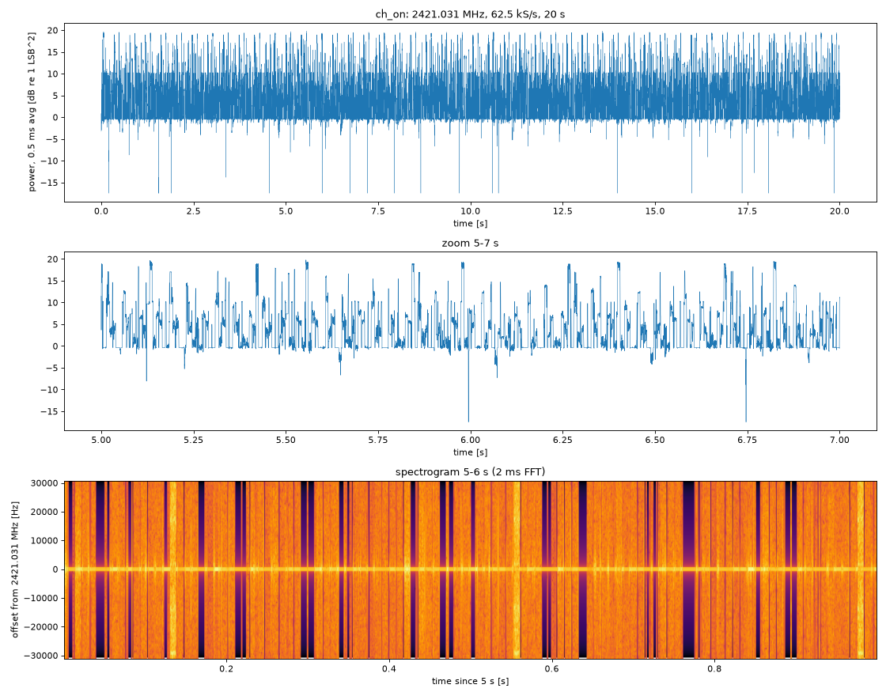
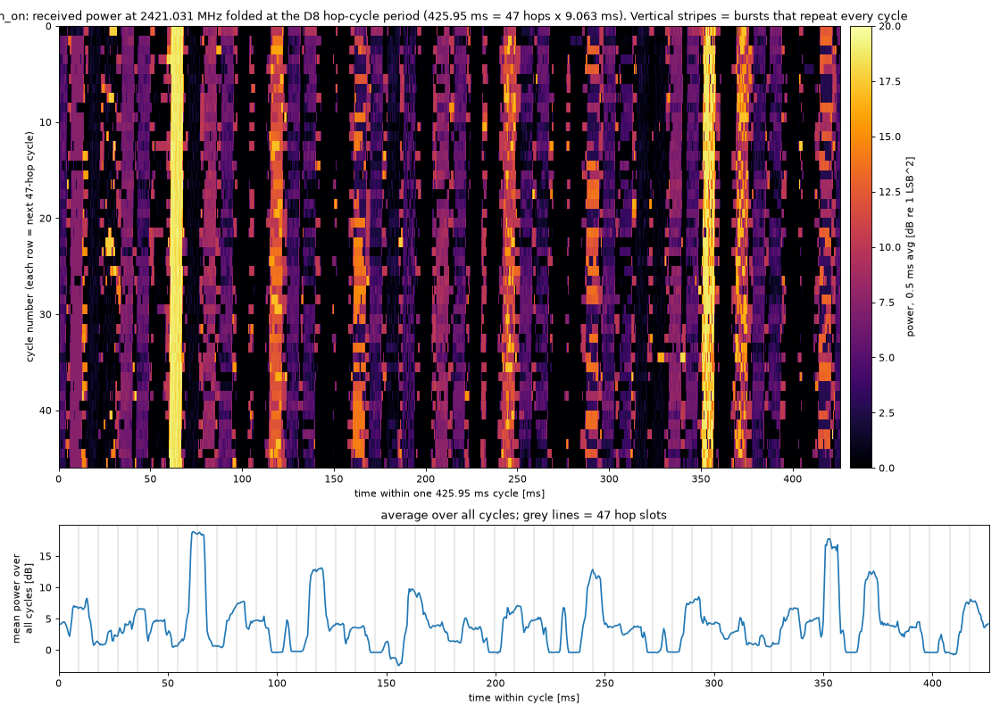

# 08 · Listening to one D8 channel

In [07](../07-d8-maxhold/README.md) the E8's energy showed up on exactly the 47 hop channels, but a max-hold spectrum throws away time. Here I wanted to look at one channel over time: what a single burst looks like, and how often the E8 comes back to that channel. From the hop table and the roughly 9 ms slot, I expected one visit about every 47 × 9 ≈ 423 ms.

I streamed 20 s near the second entry of the hop table (nominal 2421.096 MHz), with the receiver at 2421 MHz plus a 31 kHz fine offset, 2421.031 MHz. I learned in [11](../11-d8-decoding/README.md) that the E8 really transmits this channel at 2421.032 MHz, so this recording sits within 1 kHz of it. The stream ran at decimation 256, so 62.5 kS/s, with 4-bit samples and the hardware gain control. The first try came out almost empty: with the default scaling (shift 11), the 4-bit step rounded almost every sample to zero. So the host's `IqsSession` got an optional `shift`, and I recorded with shift 10. Even then the samples are small: the median magnitude is 1 step and the largest about 11.

In the power trace, averaged over 0.5 ms, there are far more bursts than the E8 should produce on one channel. Above 15 dB I counted 377 bursts in 20 s, 18.9 a second, with a median gap of 27 ms; one visit every 423 ms would be about 2.4 a second. So most of what this narrow slice picks up is not the E8 visiting this channel.

To find the repeat period anyway, I folded the trace at trial periods from 415 to 435 ms and kept the one where the folded rows line up best. That was 425.95 ms (47 × 9.063 ms), with a fold contrast of 3.92 dB against a median of 0.60 dB over all trial periods. The autocorrelation of the burst pattern agreed, with its peak at 426.0 ms. In the folded picture two stripes per cycle stand out much more than the rest. I couldn't explain them at the time and I still can't.

The 425.95 ms turned out to be wrong for the E8. The wideband strobe in [09](../09-d8-hop-cycle/README.md) gave 422.70 ms, and fitting the times of decoded packets in [14](../14-hop-follow/README.md) gave 422.50 ms. When the first decoder in [11](../11-d8-decoding/README.md) ran on this same recording, it found packets from the E8 (ID 66,178) 422.5 ms apart. So the E8's packets are in the recording at the right period, but the fold locked onto something stronger that repeats about every 426 ms. What that is, I don't know.

So one narrow channel was too sparse and too cluttered to time the hops. The recording was still useful: it became the input for the first decoder in 11, which got 31 CRC-valid packets out of it.



*Figure: received power at 2421.031 MHz, 0.5 ms average, over the full 20 s (top) and 5–7 s (middle); spectrogram of 5–6 s with 2 ms FFTs (bottom). Source: `data/ch_on.sigmf-data`, `scripts/look.py`.*



*Figure: power folded at the best period, 425.95 ms; each row is one cycle (top), average over all cycles with 47 slot lines (bottom). Source: `data/ch_on.sigmf-data`, `scripts/fold.py`.*

---

## Numbers

| What | Value | Where |
|---|---|---|
| Recording | 2421.031 MHz, 62.5 kS/s (dec 256), 4-bit, shift 10, 1,249,983 samples (20.0 s) | `data/ch_on.sigmf-meta` |
| Bursts above 15 dB / 17 dB | 377 / 263 in 20 s (18.9 / 13.2 per s) | `scripts/period.py` |
| Best fold period | 425.95 ms, contrast 3.92 dB (median 0.60 dB) | `scripts/fold.py` |
| Autocorrelation peak | 426.0 ms | `scripts/period.py` |
| Decoded E8 packet spacing (later, in 11) | 422.5 ms | `../11-d8-decoding/data/first-decode/mlse_out.txt` |

## Files

- [notes.md](notes.md): original notes.
- `data/ch_on.sigmf-*`: the 20 s recording. See [data/DATA.md](data/DATA.md).
- `scripts/fold.py`, `look.py`, `period.py`: offline (`figures/ch_on_fold.png`, `ch_on_look.png`, the burst counts and the 426 ms autocorrelation). `scripts/rec.py`: records (needs the board).

## How to re-run

Fetch the release data first: `experiments/fetch-data.sh`.

```sh
for s in fold look period; do host/.venv/bin/python experiments/08-d8-one-channel/scripts/$s.py ch_on; done
```

## Ran

2026-11-05 14:55–14:58 EST (recording 14:55–14:57, scripts 14:55–14:58). Commit 6a6510d (15:18).

[← 07-d8-maxhold](../07-d8-maxhold/README.md) · [index](../README.md) · [09-d8-hop-cycle →](../09-d8-hop-cycle/README.md)
