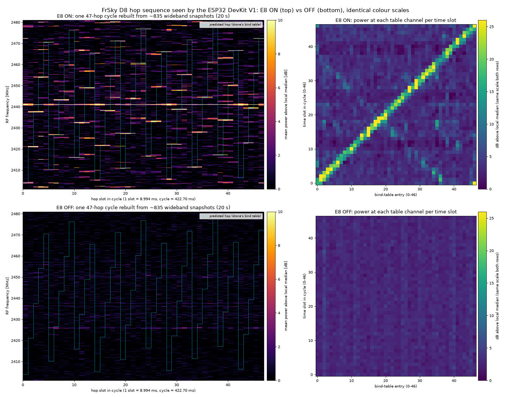

# 09 · Seeing the D8 hop cycle

[07](../07-d8-maxhold/README.md) showed the E8 on the 47 channels of the hop table, and [08](../08-d8-one-channel/README.md) showed that one channel alone was too cluttered to time the hops. I wanted to check the order and the timing: does the E8 visit the table's channels in the table's order, one slot about every 9 ms?

The board can't watch the whole band continuously, but its on-chip spectrum can take snapshots. Each snapshot is one short capture at 80 MS/s around 2441 MHz, so it covers 2401 to 2481 MHz in 2048 bins of 39 kHz, and the firmware stamps it with its position in the sample count. In 20 s I got 835 snapshots, about 24 ms apart. That is slower than the hopping, so each snapshot lands in some slot more or less at random. But the sequence repeats, so if I fold each timestamp by the cycle length, the way a strobe light freezes a spinning wheel, each snapshot falls into its place in one cycle, about 18 per slot.

For each snapshot I took the power at each of the 47 table frequencies, above the local median so the gain control doesn't matter. The frequencies come from Betaflight's CC2500 settings: channel *n* is at 2404.000 MHz + *n* × 299.93 kHz. Then for a trial cycle length and start time, I scored how much power sits on the channel the table predicts for each snapshot's slot. I searched cycle lengths from 415 to 435 ms in 0.1 ms steps. If the order is right, slot *k* lights up table entry *k*, which draws a diagonal.

The best fit was 422.70 ms, 47 slots of 8.994 ms. The matched score was 23.4 dB against 4.5 ± 0.2 dB for 200 random slot assignments, a z-score of about 89. With the E8 off, at the same period, it was 3.1 dB against 2.9 ± 0.1 dB. The diagonal is clean with the E8 on and absent with it off. So the board, sampling far too slowly to follow one hop, recovered the hop order and the slot length.



*Figure: left, one 47-slot cycle rebuilt from the snapshots, predicted hops from the bind table in cyan; right, mean power at each table channel in each time slot. E8 on (top) and off (bottom), same colour scale. Source: `data/strobe_{on,off}.npz`, `scripts/sbs.py`.*

The period was not quite right, though I didn't know it yet. When the hop follower in [14](../14-hop-follow/README.md) fitted a line through the times of thousands of decoded packets, it got 8.989 ms per slot, a 422.50 ms cycle. The strobe was 0.05% long. That is too little to matter for this picture, but enough to push retunes into packets within seconds at 111 hops a second, so the follower measures the period itself. This experiment also only sees energy; nothing here was decoded.

---

## Numbers

| What | Value | Where |
|---|---|---|
| Snapshots | 835 in 20 s, 80 MS/s, 2048 bins | `data/strobe_on.npz`, `scripts/strobe.py` |
| Fitted cycle | 422.70 ms = 47 × 8.994 ms | `scripts/strobe2.py on` |
| Matched score, E8 on | 23.4 dB vs 4.5 ± 0.2 dB random (z ≈ 89) | `scripts/strobe2.py on` |
| Matched score, E8 off | 3.1 dB vs 2.9 ± 0.1 dB random | `scripts/strobe2_off.py off` |
| Cycle measured later in 14 | 422.50 ms (8.989 ms slot) | `../14-hop-follow/data/d8follow-630s-g40.log` |

## Files

- [notes.md](notes.md): original notes.
- `data/strobe_{on,off}.npz`: the snapshots. See [data/DATA.md](data/DATA.md).
- `scripts/strobe2.py on` (`figures/hop_cycle_on.png`, searches the period), `scripts/strobe2_off.py off` (`figures/hop_cycle_off.png`, uses the fixed period 422.70 ms; recovered from `/tmp`), `scripts/sbs.py` (`hop_cycle_on_vs_off.png`): offline. `scripts/strobe.py`: records (needs the board).

## How to re-run

Fetch the release data first: `experiments/fetch-data.sh`.

```sh
S=experiments/09-d8-hop-cycle/scripts
host/.venv/bin/python $S/strobe2.py on; host/.venv/bin/python $S/strobe2_off.py off; host/.venv/bin/python $S/sbs.py
```

## Ran

2026-11-05 15:00–15:05 EST (`strobe_on.npz` 15:00, `strobe_off.npz` 15:03, `sbs.py` 15:05). Commit 6a6510d (15:18).

[← 08-d8-one-channel](../08-d8-one-channel/README.md) · [index](../README.md) · [10-fast-retune →](../10-fast-retune/README.md)
