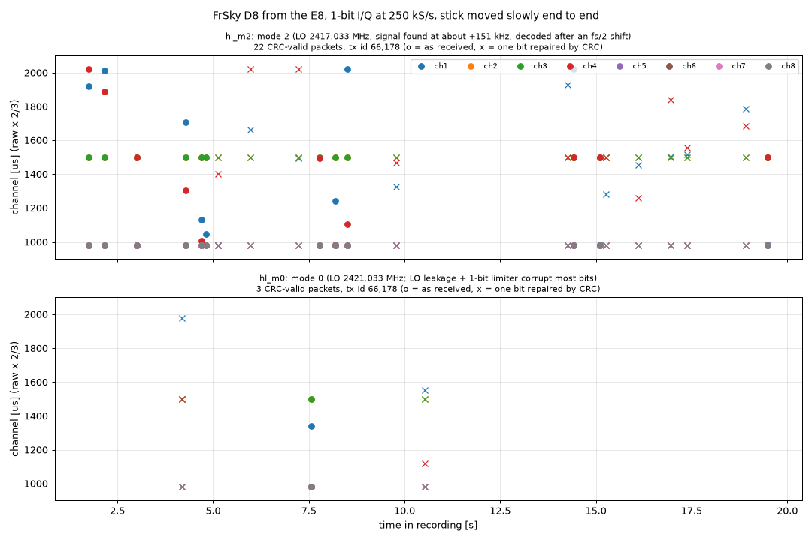
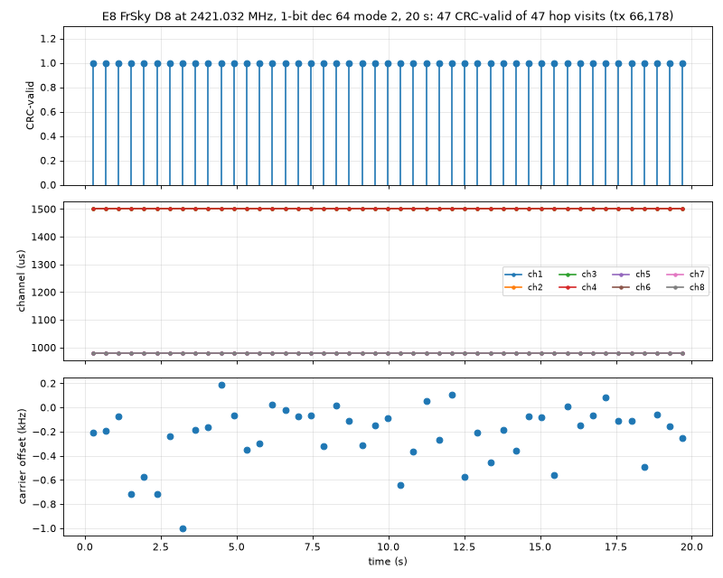

# 11 · D8 decoding: from a first packet to 47 of 47

Seeing the E8's energy was not the same as reading what it says. I wanted to decode real D8 packets, the stick positions, and then get every packet on one channel. It took four steps over about an hour and a half, each fixing what the one before showed. The 1-bit stream ([12](../12-one-bit-stream/README.md)) was built in the middle of this, and the last three steps use it.

A D8 packet is 4 preamble bytes, 2 sync bytes, a length byte, 17 bytes of data and a 2-byte CRC, 208 bits in all, about 6.7 ms at 31 kbaud. The two FSK tones sit at ±31.7 kHz. The only recording I had was the one from [08](../08-d8-one-channel/README.md): 4-bit samples at 62.5 kS/s, which covers only ±31 kHz and gives 2 samples per bit. The tones sit at the edge of the filter and fold onto each other, so a plain FM demodulator can't tell a 1 from a 0. So I wrote an offline decoder that models the whole receiver chain instead: for every possible run of 9 bits it predicts what my filters would output, then searches for the bit sequence that best matches the recording (a Viterbi search, called MLSE in the code). It found 45 packet candidates, and 31 of them had a valid CRC: 17 as received and 14 after repairing a single bit. All carried the same transmitter ID, 66,178, and sensible stick values. The CRC is what makes this trustworthy: a 16-bit checksum over the packet almost never matches if any bit is wrong. The run used `--cfo-range -4000 8000 --fix1 --all`; today's default search range of ±30 kHz finds 465 candidates and repairs more of them, 51 in total. The idea worked, but the stream format was wasting the link, which led to the 1-bit samples of 12.

With 1-bit samples a new problem came up. Every direct-conversion receiver leaks some of its own oscillator into the signal as a spike at 0 Hz, and with 1-bit samples the sign of each sample near 0 Hz is often decided by that spike. esp-sdr already had a "mode 2": tune 4 MHz below the channel, then shift the samples back by a quarter of 16 MS/s on the chip before the filter, so the channel returns to 0 Hz and the leakage ends up at −4 MHz, where the filter removes it. I recorded 20 s of the E8 channel in mode 2 and in mode 0 while moving the sticks slowly from end to end, decoded both with a range of decoder settings, and kept every CRC-valid packet. Mode 2 gave 22 and mode 0 gave 3, and the decoded stick values follow the sweep. But 22 of a possible 47 was still poor, and the mode-2 recording put the E8 at about +151 kHz instead of 0 Hz.



*Figure: decoded channel values of the stick sweep, 1-bit at 250 kS/s, mode 2 (top) and mode 0 (bottom). Dots: received exactly. Crosses: one bit repaired with the CRC. Source: `data/mode2-vs-mode0/union.pkl`, `scripts/plot.py`.*

If tuning is off by an unknown amount, nothing centred on a channel can be trusted, so next I checked the frequency convention against a reference I trust: the board's 40 MHz crystal harmonics at 2400 and 2480 MHz. I recorded them in mode 0 and mode 2 at several tunings, with and without the fine offset, at 1-bit and 8-bit, wrote down the convention, and made the host do the arithmetic: `esp32sdr stream --center F --mode 2` now picks the tuning so that F lands at 0 Hz. After the change the harmonic landed within 0.6 kHz of where it should in mode 2 at three tunings across the band, and tuning 4 MHz the wrong way showed no line. Mode 2 was now centred correctly, but the E8 still looked off.

The last step took the longest, because several things were wrong at once and each hid the others. The first was the frequency. I had been tuning to the table frequency, 2421.096 MHz, then moved to about 2421.14 MHz, where the recordings seemed to put the E8, and that made things worse. So I stopped trusting the stream and measured the E8 from 16 MS/s burst captures, at two tunings (LO 2420 and LO 2417.140), so that anything made by the receiver would move and anything real would stay put. Both put the burst midpoint at 2421.032 MHz; the median of 7 bursts was 2421.0317 MHz with a 4 kHz interquartile range. That is 64 kHz below nominal, about −26 ppm: the E8's crystal is a little slow. The "2421.14" was a second burst with the same transmitter ID in the slot just before the real one. Its apparent frequency moved with the tuning (2421.133 at LO 2417.140, about 2421.16 at LO 2421, about 2421.21 at LO 2420), so it is not on a fixed radio frequency. 9 ms earlier the E8 was on its previous hop, 2404 MHz, 17 MHz away, so I take it to be a spurious response to that packet, but I don't know the mechanism or whether the E8 or my receiver makes it.

The second was the gain. At stream start the automatic gain sometimes picks a bad setting; one recording got gain index 16 and decoded 1 packet in 20 s, with nothing in the stream looking broken. With the gain fixed anywhere from 30 to 81, nearly every packet decodes. The third was the decoder's channel filter. With 1-bit samples, ±75 kHz gave 30 CRC-valid packets on the final recording, ±35 or ±40 kHz gave 45, ±50 kHz 44, and ±30 kHz none. No single width got all 47, but their union did, so the standard decoder now tries several widths per burst and keeps a CRC-valid result.

With all three fixed, a 20 s recording centred at 2421.032 MHz, 1-bit at 250 kS/s (8.05 samples per bit), mode 2, gain 40, decoded 47 CRC-valid packets out of 47 visits to the channel. The carrier estimates of those packets came out at −0.16 kHz from 2421.032 MHz (median, s.d. 0.24 kHz), which agrees with the burst measurement. This is one channel out of 47, and I only measured the E8's true frequency on this one; live decoding came next ([13](../13-d8live-one-channel/README.md)).



*Figure: the centred recording at 2421.032 MHz, mode 2, gain 40: decoded visits (top), channel values (middle), carrier offset per packet (bottom). Source: `data/centred-decode/centred_m2.sigmf-data`; the plotting script was not kept.*

---

## Numbers

| Step | Result | Where |
|---|---|---|
| First packets (4-bit, 62.5 kS/s, MLSE) | 45 found, 31 CRC-valid (17 + 14 with one bit repaired) | `data/first-decode/mlse_out.txt` |
| Mode 2 vs mode 0 (1-bit, stick sweep) | 22 vs 3 CRC-valid | `scripts/union.py` |
| Frequency convention, mode 2 | harmonic within 0.6 kHz | [docs/devkitv1/iq-stream-uart.md](../../docs/devkitv1/iq-stream-uart.md) |
| E8 frequency from bursts | 2421.0317 MHz (median of 7, IQR 4 kHz) | `scripts/cap16_tones.py` |
| Centred, mode 2, gain 40 | 47 of 47 CRC-valid (99 candidates) | `data/centred-decode/centred_m2.sigmf-data` |

## Files

All data is listed in [data/DATA.md](data/DATA.md).

- First packets: `data/first-decode/mlse_out.txt` (the decoder's output that day), `bursts.npy`, `fits.pkl` (intermediate results). The input is `../08-d8-one-channel/data/ch_on.sigmf-data`. The decoder is now `host/esp32sdr/d8.py` (CLI `python -m esp32sdr.d8_cli`). Both today's decoder and the one at commit d1349d4 reproduce `mlse_out.txt` byte for byte with the options above. Not kept: the 40-odd exploration scripts from `/tmp/d8dec`.
- Mode 2 vs mode 0: `data/mode2-vs-mode0/hl_m{0,2}.sigmf-*` (the two recordings), `union.pkl` (all decoded packets), `m{0,2}_out.txt`, `hl_m{0,2}_r.npy` (single-setting decodes). `scripts/union.py`, `scripts/plot.py`: offline, recovered from `/tmp`. `scripts/rec1b.py`: records (needs the board).
- Frequency convention: the "Frequency convention" paragraph of [docs/iq-stream.md](../../docs/iq-stream.md) and "Centre frequency and mode 2" in [docs/devkitv1/iq-stream-uart.md](../../docs/devkitv1/iq-stream-uart.md). `data/mode2-frequency/`: `chk_m2_{33,96}`, `c96_m2`, `c140_m2`, `old_m2` (1-bit recordings of the E8 channel in mode 2 at different fine offsets). Not kept: the crystal-harmonic recordings of this step; the 0.6 kHz figure is only in the docs.
- Centred decode: [notes/centred-decode.md](notes/centred-decode.md) (the full original notes: filter-width table, the spur). `data/centred-decode/`: `cap/*.npz` (burst captures), `ruler_*`, `r1_*` (crystal-harmonic checks), `c031_m2`, `g30`…`g81` (gain), `centred_m2` (the 47/47 recording), `check`. `scripts/cap16_tones.py`, `ruler.py`, `mh2.py`: offline. `scripts/cap16_bursts.py`, `cap16run.py`, `recg.py`, `rec_centred.py`: record (need the board). `ruler.py`, `mh2.py`, `cap16run.py`, `recg.py` were recovered from `/tmp`.

## How to re-run

Fetch the release data first: `experiments/fetch-data.sh`.

```sh
# first packets (~1 min)
cd host && .venv/bin/python -m esp32sdr.d8_cli ../experiments/08-d8-one-channel/data/ch_on.sigmf-data --method mlse --cfo-range -4000 8000 --fix1 --all; cd ..
# mode 2 against mode 0
S=experiments/11-d8-decoding/scripts
OUT=/tmp/u16 host/.venv/bin/python $S/union.py        # prints 22 (mode 2) and 3 (mode 0); writes /tmp/u16/union.pkl
host/.venv/bin/python $S/plot.py                       # figures/stick_sweep.png from data/mode2-vs-mode0/union.pkl
# where the transmitter is, and 47 of 47
host/.venv/bin/python $S/cap16_tones.py                # "mid med 2421.0317 MHz", IQR 4.0 kHz
cd host && .venv/bin/python -m esp32sdr.d8_cli ../experiments/11-d8-decoding/data/centred-decode/centred_m2.sigmf-data   # 99 found, 47 CRC ok
```

For the frequency convention, with the board connected, run `esp32sdr stream --center MHZ --mode 2 --bits 1 --dec 64 ...` near 2400 or 2480 MHz and check that the harmonic sits at the expected offset.

## Ran

2026-11-05 15:40–17:07 EST:

- First packets 15:40–16:13 (start 15:40, `/tmp/d8dec` 15:41–16:01, `mlse_out.txt` 16:13). Offline only.
- Mode 2 vs mode 0 16:21–16:27 (recordings 16:21, decodes 16:22–16:27, figure 16:27).
- Frequency convention 16:30–16:41 (start 16:30, recordings 16:36–16:41).
- Centred decode 16:43–17:07 (start 16:43, burst captures 16:45–16:55, ruler 16:57, gain set 17:02, `centred_m2` 17:03, notes 17:07).

Commits 627359d and d1349d4 (decoder) at 17:26, 7ff3d7e and 663728b at 17:27.

**Overlap:** The first decode ran in parallel with [10](../10-fast-retune/README.md) and [12](../12-one-bit-stream/README.md); the mode-2 recordings were made at the end of 12, during 10.

[← 10-fast-retune](../10-fast-retune/README.md) · [index](../README.md) · [12-one-bit-stream →](../12-one-bit-stream/README.md)
