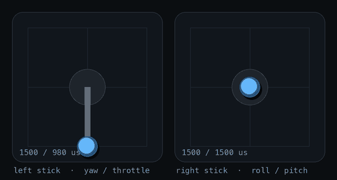

# 13 · Live decoding on one channel

By the end of [11](../11-d8-decoding/README.md) I could decode every visit of the E8 to one channel, but only offline, from a recording. I wanted to watch my sticks move on screen, decoded live from the air.

`esp32sdr d8live` streams 1-bit samples at 250 kS/s in mode 2, centred at 2421.032 MHz with manual gain 40, the settings that gave 47 of 47 in 11, and decodes as the samples arrive. Running the full decoder on every sample would take about a quarter of a core, so it only does that until the first good packet. After that it locks on: the E8 comes back to this channel every 422.6 ms, so it only decodes a 20 ms window around the next expected packet and corrects its timing from each hit. The decoded values go over a WebSocket to a small web page with two stick gimbals, bars for the eight channels and a plot over time.

In the main run, 274.2 s long, it found its first packet within the first 0.5 s and then decoded 649 CRC-valid packets, 2.37 a second. At one visit every 422.5 ms (the cycle measured precisely later, in 14), 274 s holds about 649 visits, so it got practically every one. It also logged 22 candidates that failed the CRC. Once locked it decoded only 4.9% of the samples, and the whole process used 13.3 s of CPU over the run, about 5% of a core. The stream itself was clean: 16,732 frames and 68.5 million samples with 0 lost and 0 bad CRCs. A short second run of 10.9 s gave 26 CRC-valid packets of 27 candidates.



*Figure: both sticks redrawn from 30 s of packets logged from the web page's WebSocket while the sticks were moved. Real updates arrive about 2.4 times a second; the knob glides in between. Source: `data/sticks.json`, `scripts/stickgif.py`.*

So live decoding works, and 2.37 a second is exactly what hearing 1 channel out of 47 allows. That is slow next to the roughly 111 packets a second the E8 really sends: on the page the knobs jump every 420 ms or so, and a quick flick of a stick can happen entirely between two packets. To get all of them, the board has to hop with the transmitter ([14](../14-hop-follow/README.md)).

---

## Numbers

| Run | Length | CRC-valid packets | Rate | Samples decoded | Stream loss |
|---|---|---|---|---|---|
| 1 | 274.2 s | 649 of 671 candidates | 2.37/s | 4.9% | 0 of 68,533,542 |
| 2 | 10.9 s | 26 of 27 | 2.39/s | 7.0% | 0 of 2,714,922 |

Source: `data/d8live_run1.log`, `data/d8live_run2.log`.

## Files

- `data/d8live_run1.log` (the 274 s run), `d8live_run2.log` (a short second run), `sticks.json` (30 s of packets captured from the web socket). See [data/DATA.md](data/DATA.md).
- `scripts/stickgif.py`: `figures/sticks.gif` from `sticks.json` (offline). `scripts/wslog.py`: logs packets from a running d8live.

## How to re-run

```sh
host/.venv/bin/python experiments/13-d8live-one-channel/scripts/stickgif.py   # figures/sticks.gif
esp32sdr d8live --center 2421.032 --gain 40 --open                            # live, needs the board
```

## Ran

2026-11-05 17:09–17:29 EST (start 17:09, runs 17:18, GIF 17:29). Commits b9cab94 (17:26), 549bdce (17:29).

[← 12-one-bit-stream](../12-one-bit-stream/README.md) · [index](../README.md) · [14-hop-follow →](../14-hop-follow/README.md)
