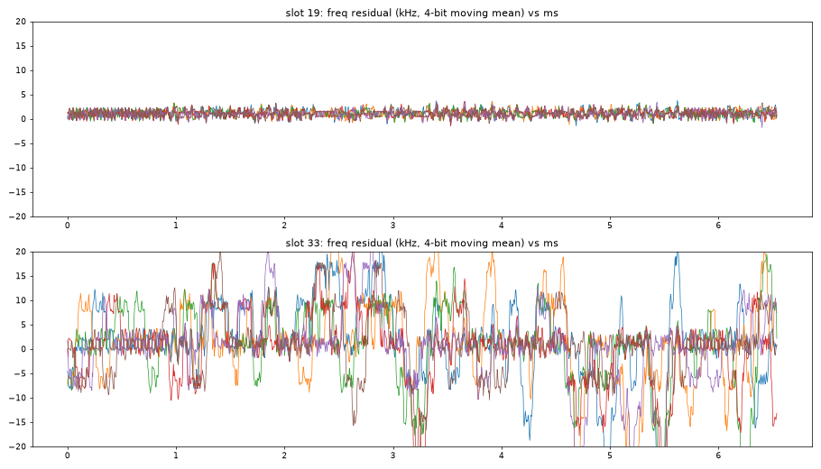
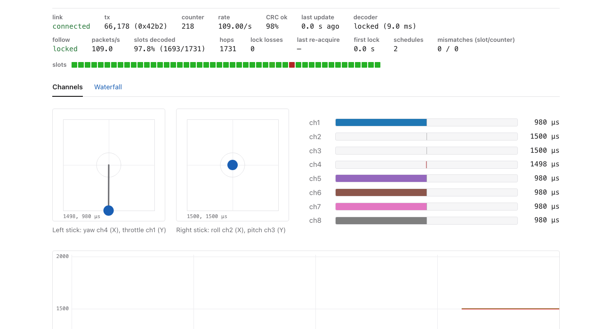
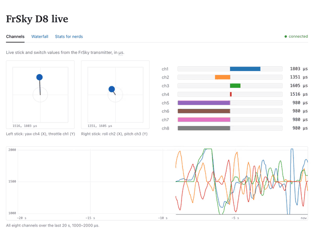
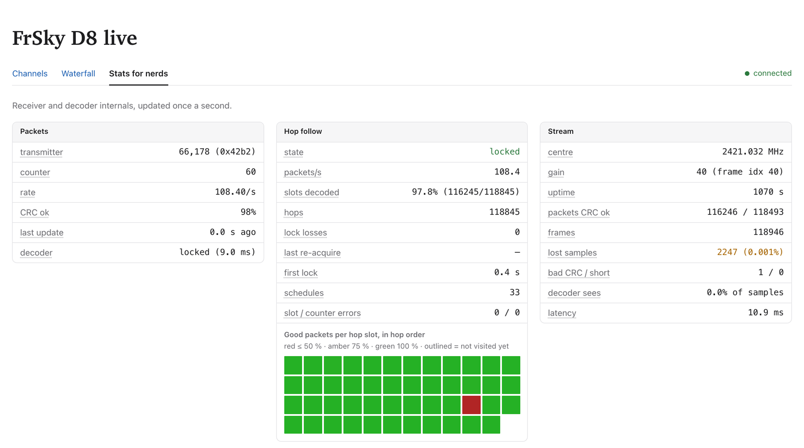
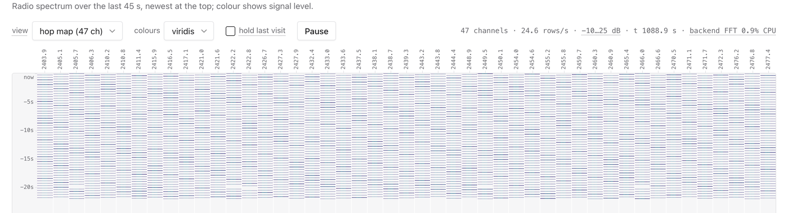
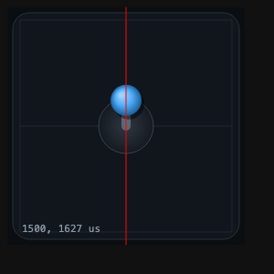

# 14 · Following all 47 hops live

On one channel the live decoder in [13](../13-d8live-one-channel/README.md) got 2.37 packets a second, one visit in 47. I wanted every packet the E8 sends, about 111 a second, which means hopping in step with it, live. [10](../10-fast-retune/README.md) showed a retune fits in the gap between packets: about 0.26 ms out of roughly 2 ms. The harder question was who decides when to retune.

A command over the UART takes a few milliseconds to arrive, and not always the same few, so the Mac can't say "retune now" 111 times a second. The board can't decide on its own either, because the decoder runs on the Mac. So I split the job. The Mac loads the 47 frequencies into the board once (`HOPTAB`). While the stream runs, it sends one short line, `HS slot pair period`: at stream sample *pair*, go to *slot*, then step to the next slot every *period*. The schedule is counted in stream samples, not in wall-clock time, so the board and the Mac agree exactly on where each hop happened, and timer jitter on the board doesn't pile up. A one-shot timer on core 0 does the retune (mode 1 from 10). The board also marks the stream: at each retune it ends the current frame, and the next frame's header says that a new channel starts here, which slot it is, and how many samples to skip while the oscillator moves.

Before trying the transmitter, I checked that retuning mid-stream doesn't break the stream. One slot put the board's 40 MHz crystal harmonic at 2400 MHz in view, the other was 10 MHz away, and the board flipped between them every 9 ms for 5 s at 1-bit, 250 kS/s, mode 2, gain 40. That was 512 retunes with 0 lost samples and 0 bad CRCs. The retune call took at most 326 µs in this run (up to 397 µs across the probe runs), and the timer fired at most 93 µs late. Segments came out a median of exactly 2250 samples apart, 9 ms. The old channel's line was gone 64 µs after the mark, and the new one was within 10% of its steady level 288–320 µs after it. Each retune is placed 1.15 ms before a packet, so that transient never reaches one.

The Mac starts by sitting on 2421.032 MHz, the channel from 11, and waits for a packet; in these runs the first came 0.14–0.40 s after the stream started. That packet's time fixes all later ones: hop *m* comes at *a* + *m*·*P*, on the next slot of the bind table. The Mac sends one `HS` so each retune lands 1.15 ms before the predicted preamble, in the middle of the gap. After that it decodes each marked segment on its own, fits a straight line through the times of the last 141 packets, and sends a new `HS` when the fit says the schedule would be more than 15 µs off ten hops ahead. If 47 hops in a row pass without a good packet, it goes back to 2421.032 MHz and waits again. I had measured the true frequency only on that one channel, 26.4 ppm low, so I applied −26.4 ppm to the whole table; packets on the other channels came in 0.3–1.8 kHz off centre, close enough.

The first long run, 159 s with `d8live --follow`, decoded 17,156 CRC-valid packets, 108.0 a second. Of 17,557 slots it was locked on, 17,155 (97.7%) gave a CRC-valid packet. There were no lock losses and no lost samples, every packet arrived on the slot the schedule said, and the packet counter went up by exactly one per hop. A WebSocket client on the page counted 108.5 packet messages a second over 145 s, 9.0 ms apart at the median. To test recovery I added `--kick`, which pushes the board's schedule 4 ms off so every retune lands mid-packet. The follower noticed after the 47 missed hops (0.44 s) and was locked again 0.114–0.366 s later, in four forced outages.

The line fit also measured the hop period properly: 8.989 ms, a 422.50 ms cycle. The strobe in [09](../09-d8-hop-cycle/README.md) had given 422.70 ms. That is 0.05% off, but at 111 hops a second it would push the retunes into the packets within a few seconds, so the follower has to measure the period rather than assume it.

The decoder was expensive at first: 91.3 s of CPU in the 159 s run, 0.575 s per second of stream, because it tried all five filter widths from 11 on every segment. A segment holds at most one packet, so it now tries the widths in the order that has worked before and stops at the first CRC-valid one. The clock recovery loop reads plain Python floats instead of numpy scalars, about 5 times faster, and the search for the packet's start does all 33 candidate times in one numpy pass. With that, a 630 s run at gain 40 used 42.8 s of CPU, 0.068 s per second, about 8 times less. It decoded 68,409 packets (108.5 a second), 97.8% of 69,926 slots, with no lock losses and 37 schedule re-sends. The only stream damage was one frame with a bad CRC, 2,248 samples lost of 157.6 million. Over those ten minutes the period crept from 8.9893 to 8.9887 ms as the two crystals drifted, and the fit tracked it. Gains 30 and 50 gave 98.0% and 97.8% in 45 s each. The board's automatic gain never locked at all in 30 s, the same failure as on one channel, so the follower uses manual gain.

One channel accounts for nearly all the missing slots. 2411.435 MHz (slot 33 in hop order, channel 25 in the bind table) passed the CRC 0% of the time in both long runs and never more than 7% at any setting I tried, while every other slot ran at 97% or better in the 159 s run and 99% or better in the 630 s run. I first assumed my receiver. Recorded alone without hopping it gave 0 packets in mode 2 and 0 in mode 0; with the centre moved ±50 and ±100 kHz, 0; at manual gain 20, 60 and 81, 0, 2 and 0; with 4-bit samples and the slow MLSE decoder, 0 of 10. In the same sessions the channels at 2410.835 and 2415.933 MHz decoded every packet (14 of 14 with MLSE). The bad channel's bursts are as strong as its neighbour's (mean power 51 against 47 in 4-bit units), 7.07 ms long, with nothing else on the channel.

The CRC-valid packet in the slot before tells me what the bad one should contain: the counter one higher and, 9 ms later, the same stick values. So I computed the ideal frequency of each bad packet and subtracted it from what I received. On a good slot (19) the residual is flat, 0.7 kHz rms. On slot 33 the carrier jumps by 8–20 kHz for 0.1–0.3 ms at a time all through the packet, 7.3 kHz rms. The tones are only ±31.7 kHz from centre, so jumps like that flip bits and often break the preamble or sync word: only 15 of 70 slot-33 segments in a 30 s run even found the sync word, and faster carrier tracking with single-bit CRC repair recovered 0–1 of 70.

My best guess is the E8's synthesizer. The CC2500 makes its carrier with a fractional-N synthesizer from a 26 MHz crystal, and for this channel the ratio is 92.74993, about 2 kHz from exactly 3/4. Synthesizers like that tend to make spurs and wander when the fraction sits just next to a simple ratio, and this is the only one of the 47 channels within 8 kHz of a ratio with denominator 8 or less; the next closest, slot 30 (4/5, 8 kHz away), decodes at 99–100%. That is an inference. I haven't looked at the E8 with a reference receiver, haven't tried another transmitter, and haven't checked whether a real D8 receiver also loses this channel. What I can say is that nothing I change on the receive side helps. The follower doesn't mind: one missed slot per cycle doesn't threaten the lock, it just caps the slot rate at 46/47, 97.9%.

So the board follows the whole D8 link in real time, at about 108 packets a second. Two things are left: the follower gives up only after 47 silent hops and then waits up to a cycle, so a real outage can cost up to about 0.9 s; and the slot-33 theory needs a proper receiver. That was the end of the receive side. Transmitting is in [esp32-d8tx](https://github.com/mb6611/esp32-d8tx).



*Figure: received frequency minus the ideal frequency of the predicted packet, kHz against ms, several packets each. Slot 19 (top) and slot 33, 2411.435 MHz (bottom). Source: a `scripts/slotrec.py` recording that was not kept, analysed with `scripts/resid.py`.*



*Figure: the d8live page in follow mode, 1693 of 1731 slots decoded (97.8%), 0 lock losses. Each square of the hit map is one hop slot in hop order; the red one is slot 33. The script that made this screenshot was not kept.*



*Figure: the same page replayed from 30 s of packets logged live while I moved both sticks, about 108 updates a second (2.4 a second on one channel in 13).*



*Figure: the Stats tab after about 18 minutes: 97.8% of slots, no lock losses. Each square is one hop slot in hop order; the red one is 2411.435 MHz.*



*Figure: about 22 s of the hop map. Each dash is one 9 ms visit. The 2411.4 MHz column looks like the others: the signal is there but does not decode.*



*Figure: headless render of the left-stick gimbal at (1500, 1627) µs; the red line marks the centre, and the knob sits on it. A check of the page drawing, not of the radio.*

---

## Numbers

| Run | Length | CRC-valid/s | Slots decoded | Lock losses | Stream loss | Decode CPU |
|---|---|---|---|---|---|---|
| `d8live --follow`, gain 40 | 159 s | 108.0 | 97.7% (17,155 of 17,557) | 0 | 0 | 91.3 s (0.575 s/s) |
| `d8follow`, gain 40 | 630 s | 108.5 | 97.8% (68,408 of 69,926) | 0 | 2,248 of 157.6 M samples | 42.8 s (0.068 s/s) |
| `d8follow`, gain 30 / 50 | 45 s each | 107.2 / 107.5 | 98.0% / 97.8% | 0 | 0 | 2.8 s |
| `d8follow --kick 12` | 60 s | 100.9 | 95.0% (4 forced outages) | 4 (forced) | 0 | – |
| `d8follow --gain hw` | 30 s | 0 | never locked | – | 0 | – |

Source: `data/d8live-follow-159s.log`, `data/d8follow-630s-g40.log`, and [notes.md](notes.md) for the shorter runs, which have no log in `data/`. Retune-in-stream check: `data/retune-in-stream.txt`.

## Files

- [notes.md](notes.md): the full original notes (design, runs, slot 33).
- `data/d8live-follow-159s.log`, `d8follow-630s-g40.log`: the two runs. `retune-in-stream.txt`: retune transients. `d8live_follow.log`, `follow_ws.json`, `test_ws.json`: other runs and web-socket captures. `d8shot/`: screenshots and screen recordings of the web page (release asset). See [data/DATA.md](data/DATA.md).
- `scripts/decode_cpu.py`: decoder CPU per hop segment, offline. `scripts/probe_hopstream.py`, `onechan.py`, `slotrec.py`: need the board. `scripts/resid.py`: slot-33 analysis of a `slotrec.py` recording. `scripts/wslog2.py`: logs a running d8live.
- Not kept: the `slotrec.py` recording behind `figures/slot33_resid.png`, and the scripts for `figures/d8live-hitmap.png` and `stick_1500_1627.png`.

## How to re-run

Fetch the release data first: `experiments/fetch-data.sh`.

```sh
host/.venv/bin/python experiments/14-hop-follow/scripts/decode_cpu.py experiments/11-d8-decoding/data/centred-decode/centred_m2.sigmf-data   # 47/47, ~0.46 ms/segment
esp32sdr d8live --follow --gain 40 --open    # live, needs the board
```

## Ran

2026-11-05 17:39–18:52 EST (`probe_hopstream.py` 17:39, 159 s run 17:52, 630 s run 18:23, screenshots 18:01–18:49, notes 18:47). Commits 3668cf7 (18:37) .. d23cefb (18:52).

[← 13-d8live-one-channel](../13-d8live-one-channel/README.md) · [index](../README.md) · [15-cc2500-rxdiag-events →](../15-cc2500-rxdiag-events/README.md)
